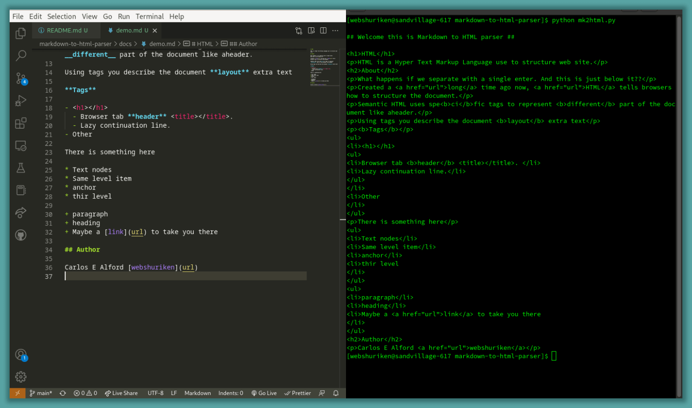

# Markdown to HTML parser

A simple markdown to html parser, module, written in Python. It is for the CS50W course project built with Django.

## About



## Tech Stack

- Django (Python)
- Markdown
- HTML
- CSS

## Run Locally

This instructions will run the program using the markdown file, `demo.md`, that was provided. Feel free to edit or change this file. The parser was made to be integrated with my Django app.

1. Clone the project

```bash
git clone https://github.com/webshuriken/markdown-to-html-parser
```

2. Using the command prompt, terminal, go to the project directory

```bash
cd my-project
```

3. In the command prompt, terminal, run Python

```bash
python
```

4. Now with Python running, import the module and use it.

```python
import mk2html

# You can call the demo function to use the demo markdown
print(mk2html.demo())

# Or you can create a markdown file inside the /docs folder, '/docs/example.md'
# then pass the name of the file you created to the function 'parse_file'.
# no need to add the file extension as the parser will auto check for a valid extension
print(mk2html.parse_file('example'))
```

## Features

- Headers, Links, Lists, Bold text and Paragraphs support
- Made to be used as a module
- Search file system for file name provided by user
- Try and catches any errors produced when accessing the markdown file.

## Markdown Syntax

[Basic markdown rules](/baisc_markdown_syntax.md)

## Roadmap

### Version 1.0.1

- [ ] output `HTML` file should have elements indented properly

### Version 1.1.0

- [ ] **paragraphs**: ability to handle line breaks.

### Version 1.2.0

- [ ] **links**: ability to handle white spaces in the url.

### Version 1.3.0

- [ ] **Emphasis**: handles italic text

### Version 1.1.0

- [ ] Horizontal rules**: creates a horizontal line, from the left to the right margin

## Acknowledgements

 - [W3schools](https://www.w3schools.com/python/)
 - [Python regex Docs](https://docs.python.org/3/howto/regex.html)
 - [Markdown guide](https://www.markdownguide.org/basic-syntax#ordered-lists)

## Authors

- [Carlos E Alford](https://www.github.com/web-shuriken)

## License

[MIT](LICENSE)
